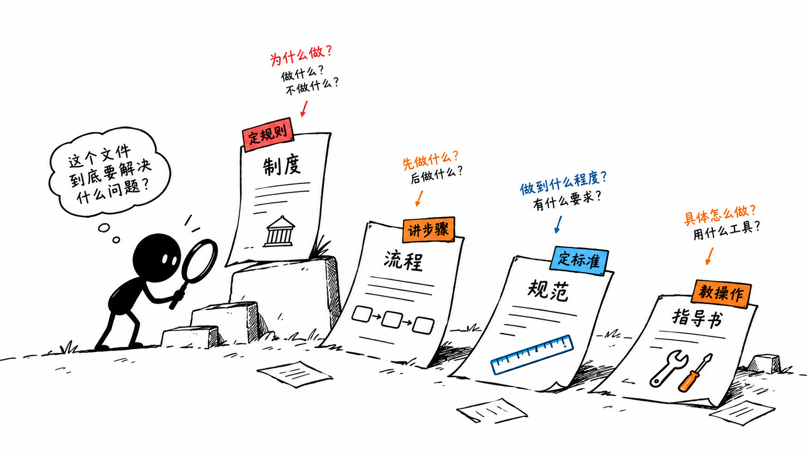

# 1.1 制度、流程、规范与指导书有什么区别

## 1.1.1 文件类型说明11111111

先通过下图了解不同文件类型的作用。

## 1.1.2 文件类型对比

![[Pasted image 20261112182229.png]]

## 1.1.3 分别理解

1. **制度：明确规则边界**

重点是管理原则、职责权限、总体要求及核心规则，回答什么能做、什么不能做，不以具体操作细节为重点。

2. **流程：说明业务如何协同完成**

重点是步骤、顺序、责任角色及输入输出，一般涉及跨部门或跨岗位协作。

3. **规范 / 标准：明确做到什么水平**

重点是技术指标、质量要求与验收条件，回答结果应达到什么水平。

4. **指导书：说明具体怎么做**

面向具体岗位或任务，提供动作、工具、参数等详细操作指引。学习课程用于建立认知，操作指导用于执行时查阅。

