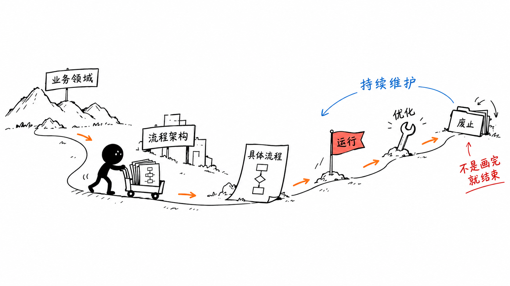

# 1.2 流程架构、分级与全生命周期

## 1.2.1 流程不是一张孤立的图

流程管理需要放在业务分类分级与流程架构中理解。阅读自己负责的流程时，应先确认它所属的业务领域、层级和上下游关系。

## 1.2.2 配图：先建立整体认识

## 1.2.3 流程的管理

按照业务规则对流程进行分类和分级，并设置相应的流程 PO，负责流程全生命周期的建设与维护，包括新建、优化、线上化、培训和废止等。

下图是流程分级示意：

![[Pasted image 20261113104732.png]]

