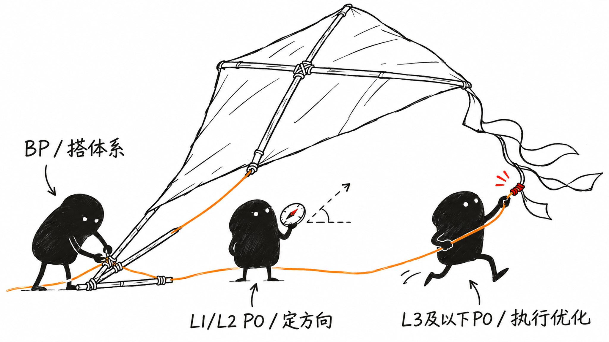

# 1.3 PO 与流程管理部门如何分工

## 1.3.1 配图：先建立整体认识

## 1.3.2 分工概览

| 角色           | 工作重点                             |
| ------------ | -------------------------------- |
| 流程管理部门 BP    | 体系搭建、方法支持、顶层框架、变革推进、绩效测评与培训赋能    |
| L1 / L2 级 PO | 主导本领域流程设计、优化与重构，关注流程目标、方向和策略     |
| L3 级及以下 PO   | 配合架构规划、流程设计、运行、自查与优化，组织培训并协调执行问题 |

![[Pasted image 20261113110938.png]]

## 1.3.3 PO 的工作不止是“录入系统”

PO 需要关注流程目标、业务协同、文件质量、运行效果和持续改进。系统中的新建、编辑、保存等操作只是其中一部分。

